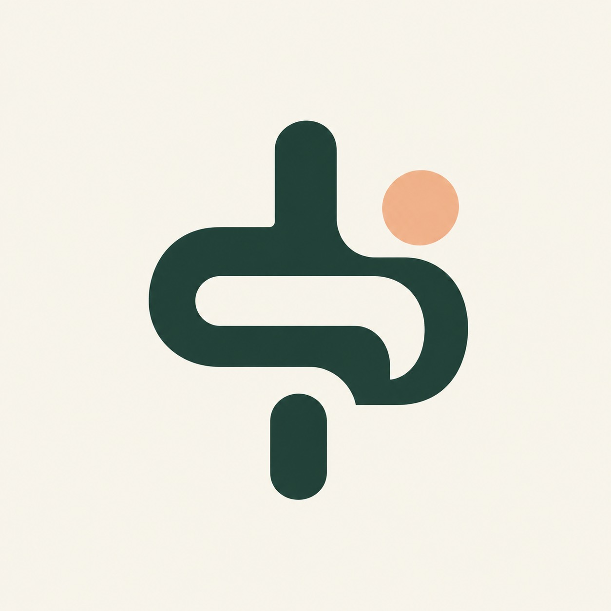

# SalehAljabr-Portfolio

<p align="center">
  
</p>

Arabic-first portfolio for Saleh Khalid Aljabr. Next.js App Router + TypeScript with static export. Preserves the approved design, content, licensed self-hosted fonts, native page transitions, and accessible original-size image viewer.

## Development
```sh
npm ci
npm run dev
```
## Validation
```sh
npm run build
npm run typecheck
```
Content and metadata: `content/pages.json`. Layout: `app/globals.css`. Interactions: `public/site.js`. Original assets and approved CV: `public/assets/`. See `ASSET-SOURCES.md` for provenance. No environment variables or database needed. Six project routes support direct links. Content works without JavaScript; reduced motion is respected.

## Vercel
Import this repository at https://vercel.com/new. Use the Next.js preset with the default build command `npm run build`. Requested project slug: `salehaljabr-portfolio` if available. Verify production Deployment Protection is disabled for public access, then test signed out.

The public Sites version remains independent and available during migration. This repository contains no other projects or Sites hosting credentials.
